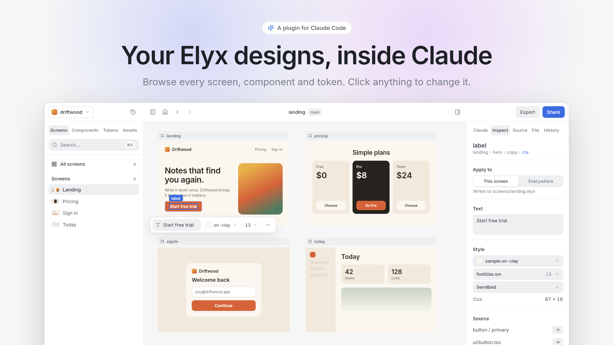
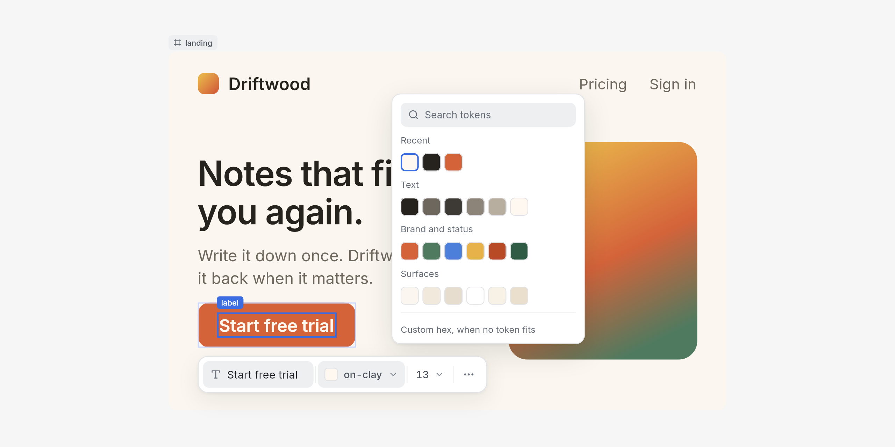
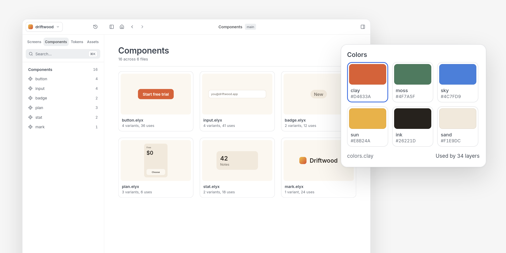
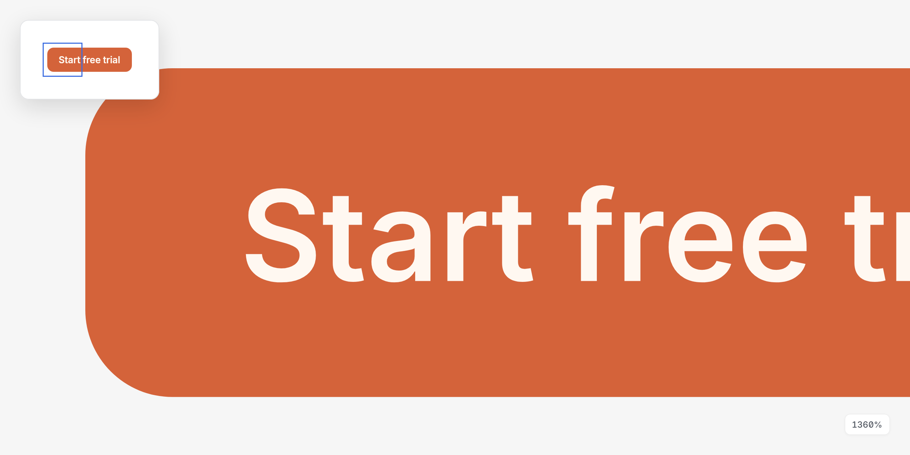
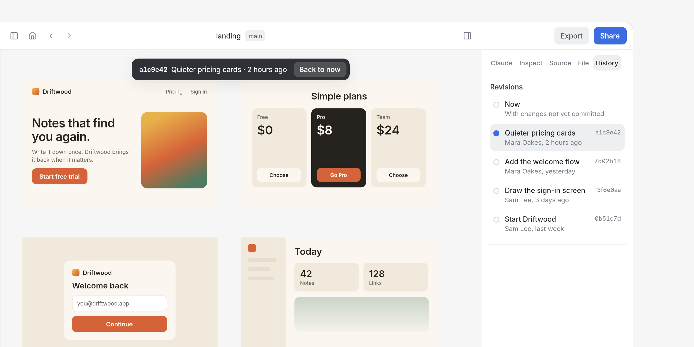
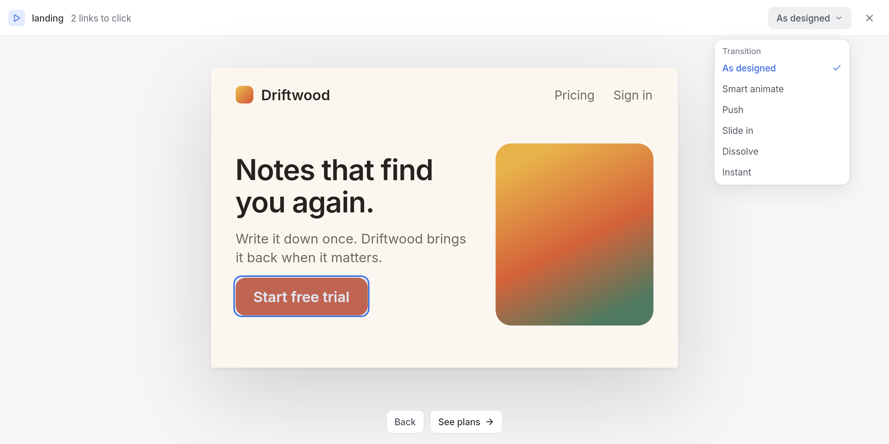
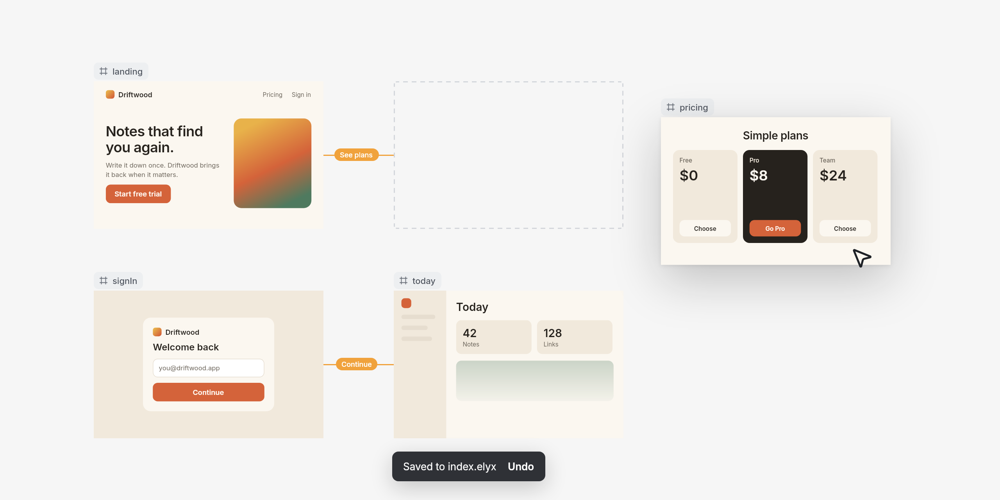

<p align="center">
  <picture>
    <source media="(prefers-color-scheme: dark)" srcset="docs/readme/hero-dark.png">
    
  </picture>
</p>

# Elyx for Claude Code

One command, `/elyx`, for working with Elyx designs from Claude Code: design something new, browse a project, or run anything the `elyx` CLI can do.

```
/elyx design a pricing card
```

Claude writes the design, checks it, and opens it on a canvas you can click through. It's an overview for designers, not an editor: you keep sight of every screen, component and token, and change the small things yourself.

## Install

You need Node.js and the Elyx CLI:

```bash
npm install --global @elyx-design/cli
```

Then, at the prompt of a terminal session:

```
/plugin install elyx-canvas --marketplace robertkeus/elyx-claude-canvas-plugin
```

Answer `y` to add the marketplace, then pick a scope.

From a shell:

```bash
claude plugin install elyx-canvas --marketplace robertkeus/elyx-claude-canvas-plugin
```

In the desktop app, where `/plugin` does not run: click **+** next to the prompt box, then **Plugins**, **Add marketplace** with `robertkeus/elyx-claude-canvas-plugin`, then **Add plugin**.

## Use

| You type | What happens |
| --- | --- |
| `/elyx` | Claude asks what you want to design, and in which style |
| `/elyx design a pricing card` | Claude writes the design, checks it and opens it on the canvas |
| `/elyx improve screens/home.elyx` | The improve agent scores the screen, fixes its weakest points within your design system, and shows before and after |
| `/elyx export the tokens of a.elyx` | Claude picks the right `elyx` command and runs it |
| `/elyx a.elyx` | Opens the file on the canvas right away |
| `/elyx --app a.elyx` | Opens the project in the Elyx app, if you have it |

The canvas opens in the Browser pane of the Claude desktop app. Elsewhere you get a URL to open yourself.

### Styles and examples

Claude designs against a library of examples instead of from scratch: six styles (studio, midnight, editorial, swiss, soft and clean), each with a nav, hero, features, pricing, testimonials, call to action and footer, plus a full page. Name a style, or Claude offers them. They live in [`examples`](examples), with open-license fonts and a [reference of 260 free icon sets](examples/icon-libraries.md) Claude fetches icons from.

Every new design gets a second look from the improve agent before you see it. You can also point it at anything you already have.

## The canvas

### Click anything, change it right there

Select a layer, however small, and a quick-edit bar opens beside it for text, color and size. Colors come from your tokens, so the design system stays intact. The inspector holds the rest, and can apply a change to this screen or to the component everywhere.

<p align="center">
  <picture>
    <source media="(prefers-color-scheme: dark)" srcset="docs/readme/quick-edit-dark.png">
    
  </picture>
</p>

### See your whole design system

Browse every component and token, with where each one is used. Components show their variants and are highlighted on the real screens that use them. Tokens show their value in every context.

<p align="center">
  <picture>
    <source media="(prefers-color-scheme: dark)" srcset="docs/readme/library-dark.png">
    
  </picture>
</p>

### Sharp at any zoom

Whatever is in view is redrawn by the Elyx engine at the exact zoom when you stop moving, so a corner stays a clean curve at 1,000% and beyond.

<p align="center">
  <picture>
    <source media="(prefers-color-scheme: dark)" srcset="docs/readme/zoom-dark.png">
    
  </picture>
</p>

### Just the canvas

Close either panel from the top bar, or press **⌘\\** for canvas mode: the bars and panels go, the window goes full screen where the browser allows it, and only your design is left. **Esc** brings everything back.

| Keys | Zoom |
| --- | --- |
| **⌘+** or **+** | In |
| **⌘−** or **−** | Out |
| **⌘0** | 100% |
| **⇧1** | Fit the whole board |
| **⇧2** | Fit the selection |

Pinch or ⌘-scroll zooms around the pointer, and the zoom menu in the toolbar lists the same keys.

### Go back to any commit

The **History** tab lists every commit that changed the board or anything it imports, newest first. Pick one and the board is drawn as that commit left it, straight from git, so you can compare before you change something. **Back to now** returns to the files on disk.

<p align="center">
  <picture>
    <source media="(prefers-color-scheme: dark)" srcset="docs/readme/history-dark.png">
    
  </picture>
</p>

### Play your prototype

**Play**, in the top bar (or **P**), shows one screen at a time at the size it fits. Every layer with a connection is a link you can click, and links on a whole screen become buttons below it. **←** goes back, **→** follows the next link, **Esc** closes.

Moving to the next screen animates. **Smart animate** pairs layers with the same name and moves each one from where it was to where it lands; the rest dissolves. **Push**, **Slide in**, **Dissolve** and **Instant** are there too, and the menu in the play bar tries any of them on the whole prototype.

<p align="center">
  <picture>
    <source media="(prefers-color-scheme: dark)" srcset="docs/readme/play-dark.png">
    
  </picture>
</p>

How a link moves is kept in the design file, in the `meta` of the layer that carries the link. Select that layer and set it in the inspector's **Prototype** section, or write it yourself:

```elyx
card = frame {
  meta: {transition: "smart", duration: "motion.medium", easing: "easing.standard"},
  connections: {target: ::detail, label: "Open"}
}
```

`duration` takes milliseconds or the name of a token, and `easing` takes a CSS easing or the name of a token. Motion tokens are number tokens in a group named for motion, in milliseconds, and string tokens holding an easing:

```elyx
export motion = tokens {fast: 150, medium: 300, slow: 500}
export easing = tokens {standard: "cubic-bezier(0.2, 0, 0, 1)"}
```

They get their own **Motion** page under Tokens, where pointing at one plays it, and play uses them when a link doesn't say otherwise.

### Share it with anyone

**Share**, top right, turns the board into a page Claude publishes as an artifact: every frame at 2×, with zoom, a link per frame, and the design's tokens. It starts private; share it from its page on claude.ai with people, your organization or anyone with the link. Sharing again updates the same page, and the link button beside Share opens it. Without the canvas, `/elyx share a.elyx` does the same.

### Arrange your board

Drag a screen and the new position is saved to the file. Drag empty canvas, or hold Space, to pan.

<p align="center">
  <picture>
    <source media="(prefers-color-scheme: dark)" srcset="docs/readme/drag-dark.png">
    
  </picture>
</p>

### And more

- **Export** any layer or a whole board as PNG at any size (`@2x`, `@3x`), JPG, WebP, vector SVG or CSS. Files land in an `exports` folder in your project.
- **Switch projects** from the top bar when a repository holds more than one Elyx project.
- **Search** the whole project with ⌘K, including the text inside layers.
- **Context**, in the toolbar, switches a design between themes and surfaces.
- **Ask Claude**, in the toolbar, opens the Claude tab: bigger changes go to the session that opened the canvas, with the selected layer as context.

## Your files stay yours

Edits change one property and leave every other line alone, so your diffs show only what you changed. Each edit is checked with `elyx diagnostics`. A change that adds a problem is reverted, and Undo takes back the rest.

While it draws, the canvas keeps a short-lived file in a hidden `.elyx-canvas` folder in your project, because imports only resolve from inside it. The folder goes away with the canvas.

## License

MIT, see [LICENSE](LICENSE). The bundled Lucide icons keep their own license, see [THIRD_PARTY_NOTICES.md](THIRD_PARTY_NOTICES.md).

<sub>Driftwood, the product in these images, is a made-up sample.</sub>
